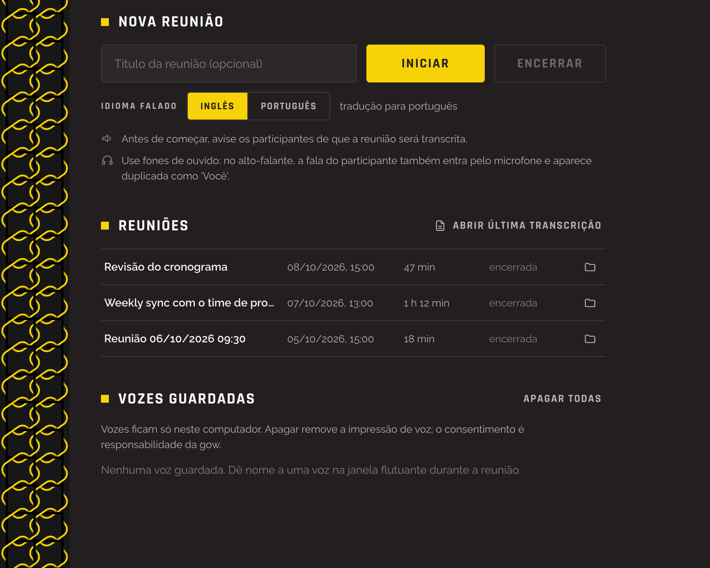
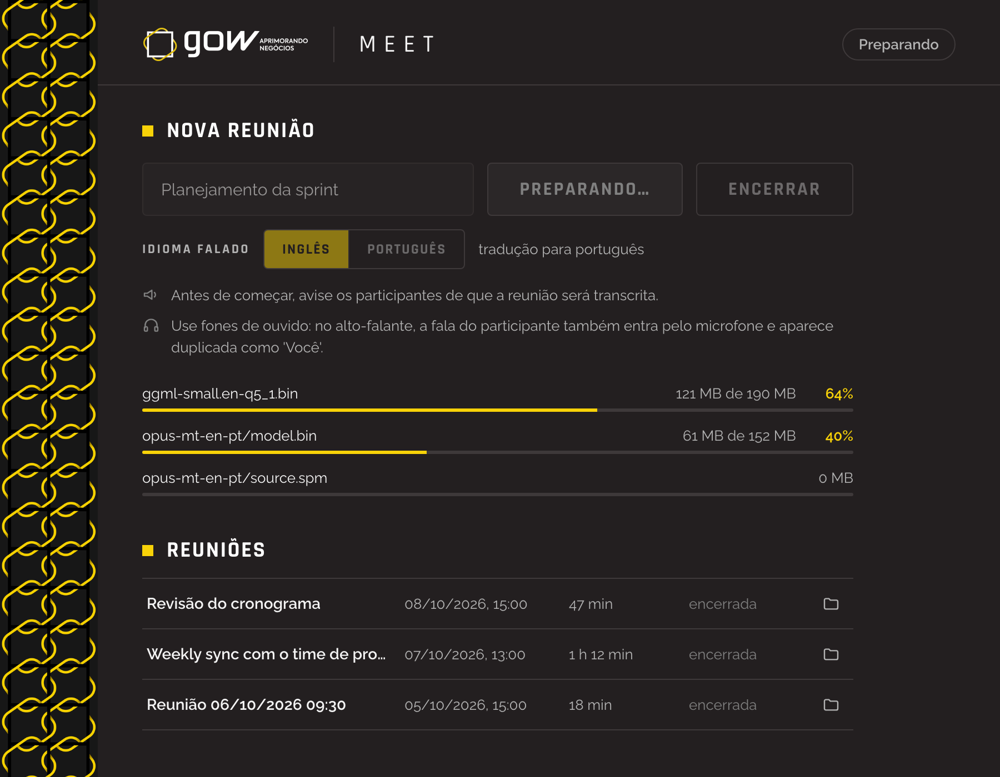
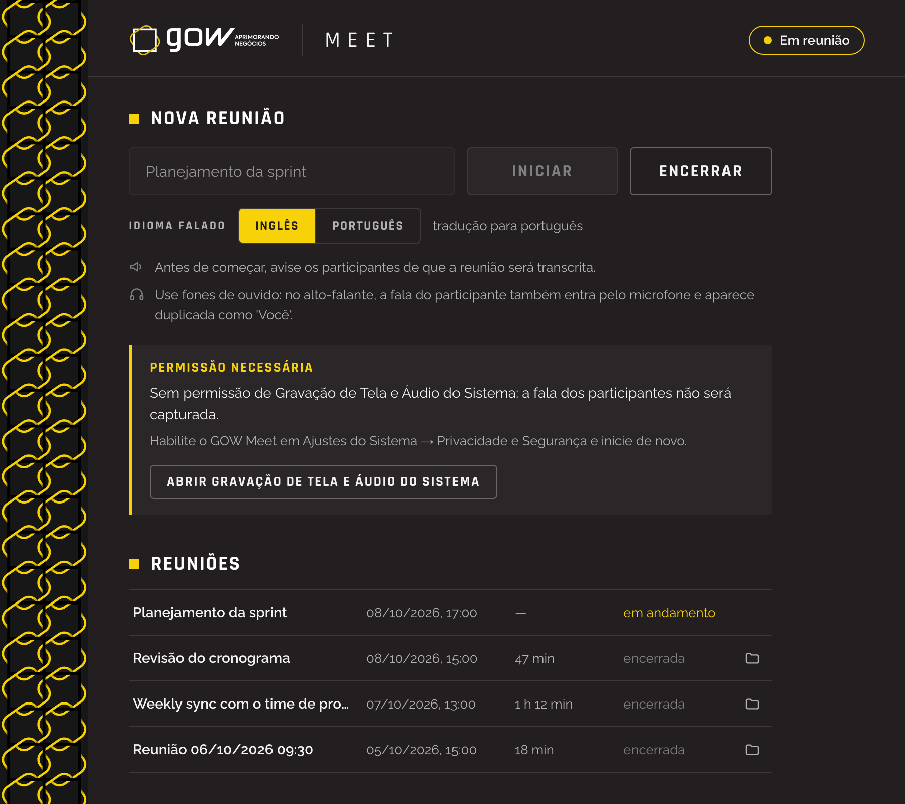
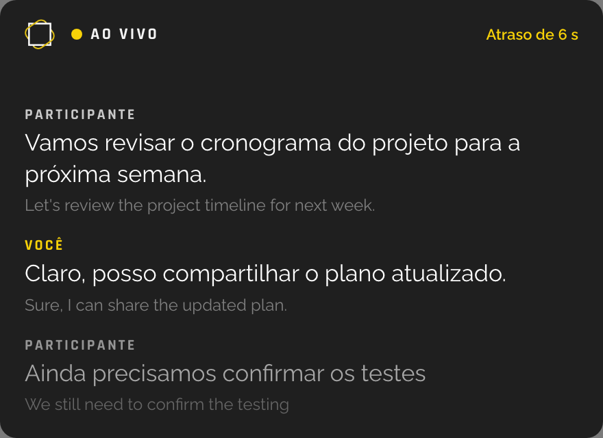
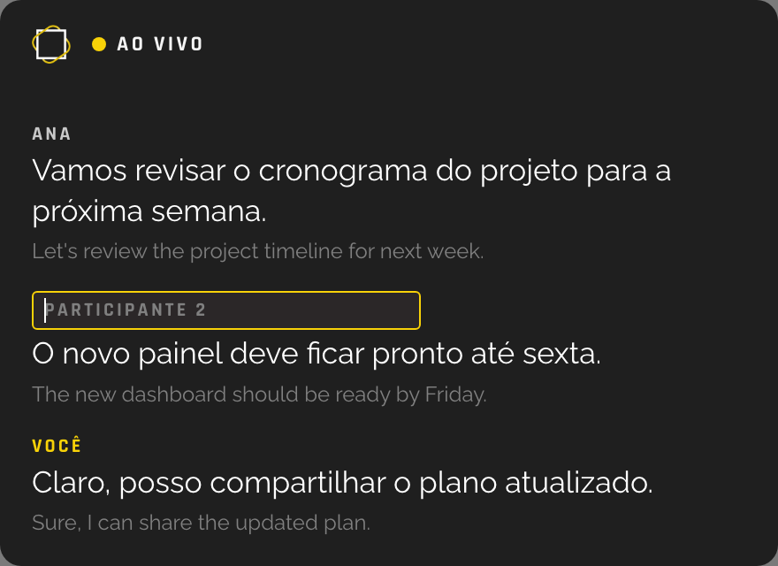
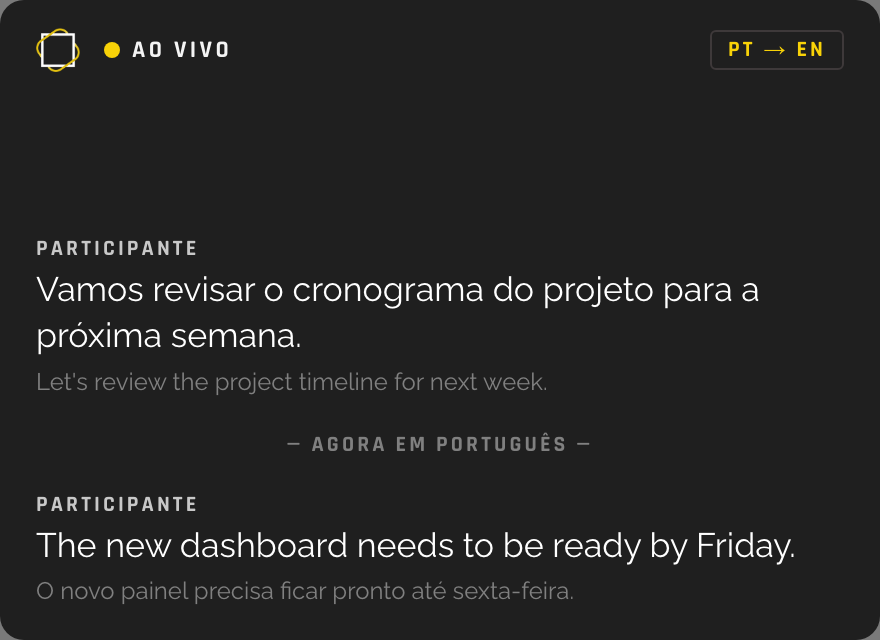
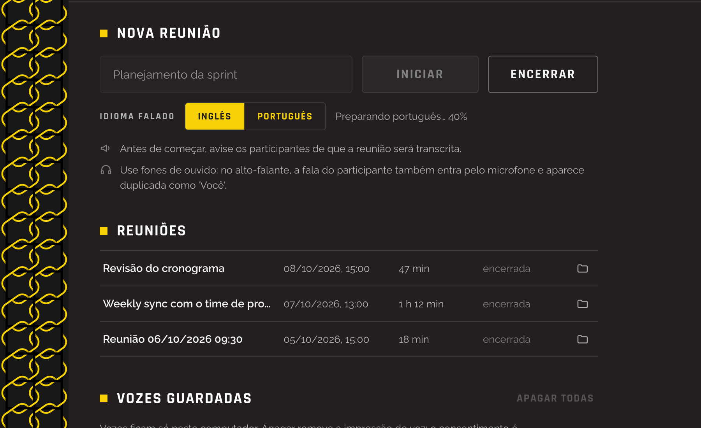
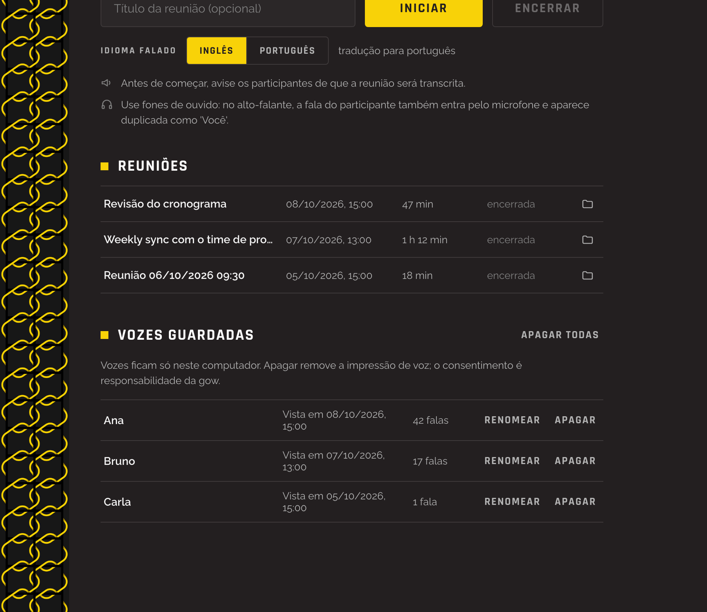

# Como usar o GOW Meet

O GOW Meet mostra legendas traduzidas das suas reuniões, ao vivo, numa janela flutuante.
Funciona com qualquer app de reunião (Teams, Zoom, Meet no navegador…), porque escuta o
áudio do computador e o seu microfone. Tudo roda no seu computador: o áudio nunca sai da
máquina e não é gravado; só o texto da reunião fica salvo.

> As imagens deste tutorial usam nomes e falas fictícios.

## 1. Instalar

Baixe a versão mais recente em
**[Releases](https://github.com/washjunio/gow-meet/releases/latest)**.

**macOS (Apple Silicon, macOS 13 ou mais novo)**

1. Abra o `GOW.Meet_<versão>_aarch64.dmg` e arraste o **GOW Meet** para **Aplicativos**.
2. Na primeira abertura o macOS bloqueia o app, porque ele não tem assinatura da Apple.
   Abra **Ajustes do Sistema → Privacidade e Segurança**, role até o fim e clique em
   **Abrir Mesmo Assim**.
3. Se o macOS disser que o app "está danificado", rode no Terminal
   `xattr -cr "/Applications/GOW Meet.app"` e abra de novo.

**Windows 10/11**

1. Rode o `GOW.Meet_<versão>_x64-setup.exe`.
2. O Windows avisa que o instalador não é reconhecido: clique em **Mais informações →
   Executar assim mesmo**.

## 2. Primeira reunião

1. **Avise os participantes** de que a reunião será transcrita.
2. Use **fones de ouvido**. No alto-falante, a voz dos participantes também entra pelo seu
   microfone e aparece duplicada como "Você".
3. Dê um **título** à reunião (opcional; sem título, o app usa a data e a hora).
4. Escolha o **idioma falado**:
   - **Inglês**: legendas traduzidas para o português;
   - **Português**: legendas traduzidas para o inglês.
5. Clique em **Iniciar**.

Na primeira vez em cada idioma, o app baixa os modelos de transcrição e tradução (cerca de
430 MB para o inglês e 260 MB para o português). A janela mostra o andamento; depois disso o
app funciona sem internet.

### Permissões

Na primeira reunião o sistema pede acesso ao **microfone** e, no macOS, à **gravação de tela
e áudio do sistema** (só o áudio é usado; nenhuma imagem da tela é guardada). Se alguma
permissão faltar, a janela principal mostra um aviso com o botão que abre o ajuste certo.
Depois de liberar, encerre e inicie a reunião de novo.

No Windows, se a sua voz não aparecer, confira **Configurações → Privacidade e segurança →
Microfone** e ative **Permitir que aplicativos da área de trabalho acessem o microfone**.

## 3. Durante a reunião: a janela flutuante

Ao iniciar, abre uma janela flutuante que fica por cima das outras. Arraste-a por qualquer
ponto para onde for mais confortável e redimensione pelas bordas.

- Cada fala mostra **quem falou**, a **tradução** (texto maior) e o **original** (texto menor).
- **Você** é o seu microfone; **Participante** é o áudio do computador.
- A fala em cinza claro ainda está em andamento e pode mudar até a pessoa terminar a frase.
- Se as legendas atrasarem, o canto direito mostra **Atraso de N s**.

### Dar nome a quem fala

O app separa os participantes pela voz (**Participante 1**, **Participante 2**…). Clique no
rótulo, digite o nome e tecle **Enter**. Todas as falas daquela voz passam a mostrar o nome.

O app lembra das vozes nomeadas: nas próximas reuniões, neste computador, a mesma pessoa já
aparece com o nome.

### Trocar de idioma no meio da reunião

Se a conversa mudar de idioma, clique no indicador de idioma da janela flutuante
(**EN → PT** ou **PT → EN**), ou escolha o outro idioma na janela principal. As legendas
seguintes saem no novo idioma, e a transcrição marca o ponto da troca.

Se os modelos do outro idioma ainda não estiverem no computador, a janela principal mostra
**Preparando… N%** enquanto baixa; as legendas continuam no idioma atual até terminar.

## 4. Encerrar e abrir a transcrição

Clique em **Encerrar** na janela principal. A janela flutuante fecha e a transcrição é salva
em Markdown, com quem falou, o horário, o original e a tradução.

Na lista **Reuniões**:

- clique numa reunião para **abrir a transcrição** no seu editor padrão;
- clique no ícone de **pasta** à direita para **mostrar o arquivo no Finder** (macOS) ou no
  **Explorador de Arquivos** (Windows) — útil para anexar ou compartilhar;
- **Abrir última transcrição**, no alto da lista, abre a reunião mais recente.

## 5. Vozes guardadas

A seção **Vozes guardadas** lista as vozes que você nomeou. Elas ficam só neste computador.
Você pode **renomear** ou **apagar** uma voz, ou **apagar todas**. Apagar remove a impressão
de voz; a pessoa volta a aparecer como "Participante N" nas próximas reuniões. As vozes só
podem ser alteradas com a reunião encerrada.

## Dicas e problemas comuns

| Situação | O que fazer |
|---|---|
| Minha fala aparece duplicada como "Você" | Use fones de ouvido. |
| As falas dos participantes não aparecem | Confira a permissão de gravação de tela e áudio do sistema (macOS) e se o som da reunião está saindo pelo dispositivo padrão (Windows). |
| As legendas atrasam muito | Feche apps pesados; no notebook, deixe-o na tomada. |
| Troquei de fone no meio da reunião | O app reconecta sozinho ao novo dispositivo em alguns segundos. |
| Uma pessoa recebeu o nome errado | Clique no nome na janela flutuante e corrija; ou renomeie em **Vozes guardadas**. |

Onde ficam os arquivos (transcrições, vozes, modelos e logs): veja a seção
**Onde ficam os dados** do [README](../README.md#onde-ficam-os-dados).
